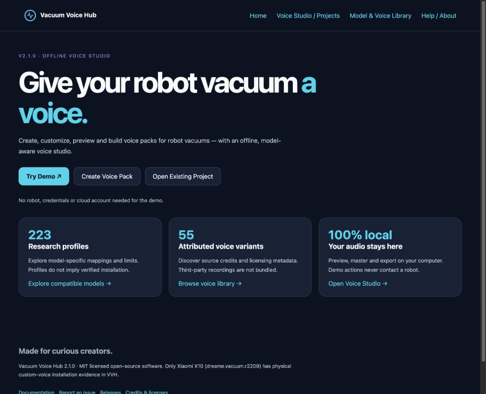
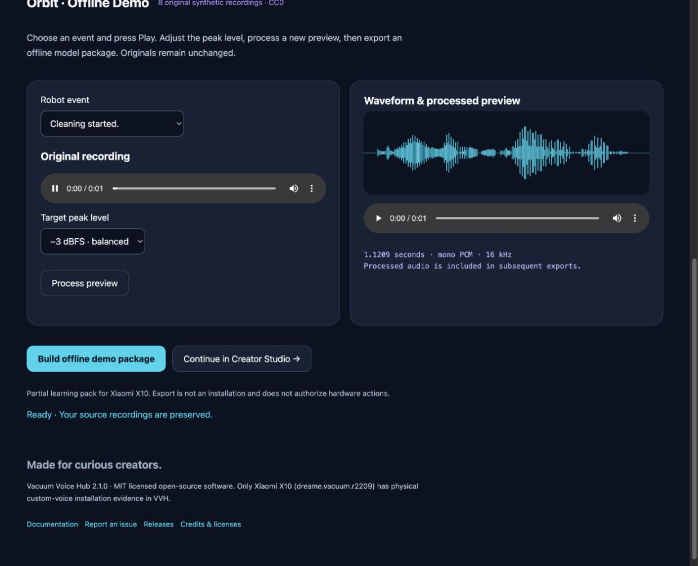

<p align="center"><picture><source media="(prefers-color-scheme: dark)" srcset="vacuum_voice_hub/brand/wordmark-dark.svg"></picture></p>

# Give your robot vacuum a voice.

Create, customize, preview and build voice packs for robot vacuums — with an
offline, model-aware voice studio. Open source, local processing, no cloud account.



**v2.1.0 release preparation:** the source and native packaging are under acceptance.
[Published releases](https://github.com/aitishnyk/vacuum-voice-hub/releases)
are the authoritative download list. v2.0.0 is a source/catalog release.
Do not treat build recipes or an unverified ZIP as a tested desktop installer.

[Getting started](docs/GETTING_STARTED.md) · [Installation](docs/INSTALLATION.md) ·
[Demo tutorial](docs/DEMO_TUTORIAL.md) · [Compatibility guide](docs/COMPATIBILITY_GUIDE.md) ·
[Public catalog](https://aitishnyk.github.io/vacuum-voice-hub/)

## Try it locally

With Python 3.12, from a release checkout:

```sh
python3.12 -m venv .venv
. .venv/bin/activate
python -m pip install '.[desktop,review-signing]'
vvh desktop
```

Windows and Linux instructions are in [Installation](docs/INSTALLATION.md).
Once open, select **Try Demo → Play → Process preview → Build offline demo package**.
The eight bundled synthetic recordings work offline without a robot, credentials,
optional TTS engines or your own audio. Originals remain unchanged. Demo export
is a partial learning pack, never a hardware install.



## Make something yours

- **Voice Studio:** semantic event assignment, imports, local audio previews,
  waveform selection, non-destructive mastering and model-specific builds.
- **Projects:** create, reopen, save metadata, validate, back up and restore.
- **Universal Studio:** inspect event mapping, audio hashes, language coverage
  and preflight readiness together.
- **Offline TTS:** optional local Piper/eSpeak workflows, separately licensed models.
- **Model and Voice Libraries:** canonical research profiles and attributed
  upstream voice variants, with credits and redistribution metadata.
- **Review and integrity:** human recording review, SHA-256, provenance,
  firmware evidence, reviewer handoff and recovery tools.

Third-party voice catalog entries are not bundled recordings or permission to
redistribute them. Local previews require audio you have the right to use.

## Compatibility without guesswork

**223 research profiles · 55 attributed voice variants · 22 text script locales.**
These are not 223 tested installations or 22 prerecorded languages.
Only **Xiaomi X10 (`dreame.vacuum.r2209`)** has physical custom-voice installation
evidence in VVH. Other profiles distinguish experimental transport, build/preview
only and vendor restrictions. Successful offline export never grants hardware
installation permission. Existing IDs, aliases, package formats and CLI remain intact.

See [Compatibility](docs/COMPATIBILITY_GUIDE.md), [Model matrix](docs/MODEL_MATRIX.md),
and [Community hardware testing](docs/COMMUNITY_HARDWARE_TESTING.md).

## Documentation and help

[Creator guide](docs/CREATOR_STUDIO.md) · [Voice pack creation](docs/VOICE_PACK_CREATION.md) ·
[Backup and recovery](docs/CREATOR_RECOVERY_V190.md) ·
[Troubleshooting](docs/TROUBLESHOOTING.md) · [Privacy and security](docs/PRIVACY_SECURITY.md) ·
[Developer guide](docs/DEVELOPER_GUIDE.md) · [Release notes](docs/RELEASE_NOTES_V210.md)

## Contribute

[Report a bug or request a feature](https://github.com/aitishnyk/vacuum-voice-hub/issues) ·
[Contributing](CONTRIBUTING.md) · [Security reporting](SECURITY.md) ·
[Credits](CREDITS.md) · [Third-party audio](THIRD_PARTY_AUDIO.md) · [MIT license](LICENSE)

[Changelog](CHANGELOG.md) preserves release history. [Roadmap](ROADMAP.md) describes
current work and limits. No green CI badge substitutes for an actual acceptance report.
